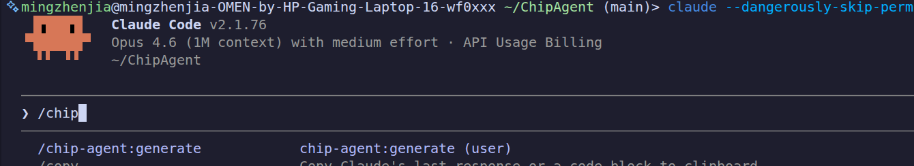

# ChipAgent
ChipAgent: An AI-powered autonomous agent for full-chip design flow, from natural language requirements to synthesizable RISC-V RTL with automatic verification.

## How to install
```
npx chip-agent
```
to install chip-agent

## How to run
In claude code ,press/chip-agent

