# ChipAgent

ChipAgent 是一个 Claude Code 硬件设计插件：将自然语言需求转换为 Chisel/Verilog，并通过 lint、仿真和物理实现流程生成验证结果与 PPA 报告。它也支持直接从 Chipyard 配置生成 SoC RTL，再完成 SRAM 映射和 OpenROAD 布局布线。

## 架构

```mermaid
flowchart TD
    User[自然语言需求 / Chipyard 配置] --> Skills[skills：命令入口与流程编排]
    Skills --> Agents[agents：需求解析、代码生成、测试与诊断]
    Skills --> Scripts[scripts：编译、lint、仿真与环境检测]
    Skills --> MCP[MCP 后端：ORFS 执行、指标与参数迭代]
    Agents --> Source[共享 Chisel 源码]
    Source --> Scripts
    Scripts --> Workspace[MyDesign / 模块 / workspace]
    MCP --> Local[本地 ORFS]
    MCP --> Docker[Docker ORFS]
    Local --> Workspace
    Docker --> Workspace
```



| 层 | 目录 | 职责 |
|---|---|---|
| 命令与编排 | `skills/` | 定义 `/chip-agent:*` 命令，串联步骤、选择 local/docker 流程 |
| 专项生成与分析 | `agents/` | 需求解析、Chisel/testbench 生成、SRAM 映射、PnR 迭代与报告 |
| 工具执行 | `scripts/` | 调用 sbt、Verilator 等；`_common.sh` 统一解析模块路径 |
| 物理实现后端 | `mcp-server*/` | 通过 MCP 提供环境检查、配置生成、阶段执行、报告、诊断、清理与轮次比较 |
| 共享源码工程 | `chisel-project/` | 固定 Chisel/Scala/sbt 配置，`Generate.scala` 注册可编译模块 |
| 安装与模板 | `bin/install.js`、`templates/` | 分发命令、agents、后端和工程模板；`scripts/install.sh` 转发到同一安装器 |

### 两条设计流程

- **自定义模块**：需求 → `spec.json` → Chisel → Verilog → lint → C++ testbench → 仿真 → 验证报告；之后可用 `pnr` 进行物理实现。
- **Chipyard SoC**：配置 → RTL → SRAM 分析/宏映射 → ORFS 综合、floorplan、place、CTS、route、finish → PPA/GDS。`chipyard` 和 `chipyard-pnr` 按项目的 `backend_mode` 路由到 local/docker 命令。

### MCP 后端边界

| 实现 | MCP 名称 | 用途 | 配置来源 |
|---|---|---|---|
| `mcp-server/`（TypeScript） | `chipagent-backend` | 默认安装后端，提供通用 ORFS 工具；保留原有 Docker 执行兼容 | `~/.chipagent/workspace.json`（可选）；本地 ORFS 也支持 `ORFS_DIR` 和路径探测 |
| `mcp-server-python/` | `chipagent-backend` | 可选的本地 Python 实现，与默认后端二选一 | `<PROJECT_ROOT>/.chipagent/env.json` |
| `mcp-server-docker-python/` | `chipagent-backend-docker` | Chipyard Docker PnR 后端；额外提供阶段指标和案例库 | `<PROJECT_ROOT>/.chipagent/env.json` |

`backend_mode` 控制 skill 路由，**不会自动注册或替换 MCP 服务**。安装器默认注册 TypeScript 后端，并复制两个 Python 后端的源码；Docker 流程还需按下文注册 `chipagent-backend-docker`。

## 安装

从源码安装到指定项目（推荐，便于隔离）：

```bash
node bin/install.js --local /path/to/design-project
```

安装到用户级命令目录，并在当前目录准备设计工程：

```bash
node /path/to/ChipAgent/bin/install.js --global
```

npm 分发入口为 `npx chip-agent`，支持相同参数。安装器需要支持 `--experimental-strip-types` 的 Node.js；它会先检查运行能力，再为 TypeScript MCP 安装 npm 依赖。重启 Claude Code 后使用命令。

| 内容 | `--local DIR` | `--global`（默认） |
|---|---|---|
| 命令 | `DIR/.claude/commands/chip-agent/` | `~/.claude/commands/chip-agent/` |
| agents、MCP 后端 | `DIR/.claude/` | `~/.claude/` |
| 带附属文件的 skill | `DIR/.claude/skills/` | `~/.claude/skills/` |
| scripts、Chisel 工程 | `DIR/` | 当前工作目录 |
| 项目说明模板 | `DIR/CLAUDE.md` | 当前目录的 `CLAUDE.md` |
| MCP 注册 | `DIR/.mcp.json` | 已有 `~/.claude.json` 或 `~/.claude/settings.json`，否则创建前者 |

已有 `CLAUDE.md` 会保留。安装不会复制本地 `node_modules`、sbt 构建缓存和 Python 缓存。仓库根目录的 `.mcp.json` 直接指向源码后端，仅用于在本仓库开发。

### 工具环境

- 自定义 Chisel 模块：JDK 11+、sbt；lint/仿真还需要 Verilator、Make 和 C++ 编译器。工程固定 **Chisel 3.6.1、Scala 2.13.10、sbt 1.10.7**；系统 Scala 可不安装。
- 本地物理实现：OpenROAD-flow-scripts（ORFS）及其 Yosys、OpenROAD、sky130hd PDK；GDS 导出需要 KLayout 和对应 cell/macro GDS。
- 本地 Chipyard：另需 Chipyard 安装和其工具链。
- Docker Chipyard/PnR：宿主机使用 Bash、Docker 和 Python 3.10+ 运行编排，EDA 工具和 PDK 来自两个镜像：`ictmrc/chipyard-image:1.9.1-ubuntu-22.04`、`openroad/orfs:latest`。不要求宿主机安装 Chipyard 或 ORFS；项目文件从 `PROJECT_ROOT` 挂载，运行产物保存在项目内。

### 注册 Docker 后端

以本地安装为例，在设计项目中创建 Python 环境：

```bash
python3 -m venv .venv
.venv/bin/python -m pip install -r .claude/mcp-server-docker-python/requirements.txt
```

将以下服务**合并**到项目 `.mcp.json` 的 `mcpServers` 中，路径替换为实际绝对路径（全局安装的后端脚本在 `~/.claude/`）：

```json
{
  "chipagent-backend-docker": {
    "type": "stdio",
    "command": "/path/to/design-project/.venv/bin/python",
    "args": ["/path/to/design-project/.claude/mcp-server-docker-python/server.py"],
    "env": {"PROJECT_ROOT": "/path/to/design-project"}
  }
}
```

Python 后端使用显式 `PROJECT_ROOT`，未设置时使用进程工作目录，不从安装目录推断项目位置。可选本地 Python 后端使用自己的 `requirements.txt`，并将 `chipagent-backend` 的入口替换为 `mcp-server-python/server.py`。

先运行 `/chip-agent:initialize`，再确认项目 `.chipagent/env.json` 中的 `backend_mode` 为 `docker`。ORFS 镜像与容器工作目录可通过 `docker_config.image`、`docker_config.workdir` 配置。

## 使用

```text
/chip-agent:initialize
/chip-agent:workflow An 8-bit ALU supporting ADD, SUB, AND, OR
/chip-agent:pnr ALU8

/chip-agent:chipyard tinyrocket
/chip-agent:chipyard-pnr tinyrocket 100MHz
```

| 命令 | 功能 |
|---|---|
| `workflow <描述>` | 需求、生成、编译、lint、testbench、仿真与报告 |
| `generate <描述>` | 仅解析需求和生成 Chisel |
| `requirement-parser <描述>` | 写入结构化 `spec.json` |
| `compile / lint / testbench / simulate <模块>` | 单独运行对应阶段 |
| `debug <模块>` | 对照 spec、源码、仿真日志与 VCD 分析失败 |
| `pnr <模块>` | 通用 RTL 的 ORFS 物理实现与结果报告 |
| `chipyard / chipyard-pnr <配置>` | Chipyard 统一入口，按环境选择本地或 Docker |
| `chipyard-rtl <配置>` | 直接生成/调试 Chipyard RTL 的辅助入口 |
| `sram-mapping <RTL 路径>` | 分析 SRAM 及宏映射策略 |
| `chipyard-pnr-test <配置>` | Docker PnR 参数探索，附带指标、失败特征与参数参考 |
| `sync-back` | 比较已安装项目与源码，选择性同步修改 |

所有命令均带 `/chip-agent:` 前缀；`*-local` 和 `*-docker` 命令也可直接调用。

### 项目数据布局

```text
<design-project>/
├── .claude/                      # 本地安装的命令、agents、MCP 源码
├── .chipagent/env.json           # 当前机器的能力和路由配置
├── scripts/                     # 项目内的工具脚本
├── chisel-project/              # 所有自定义模块共享的 Scala 源码
│   └── src/main/scala/chipagent/
│       ├── Generate.scala       # 模块注册与 Verilog 输出入口
│       └── <Module>.scala
└── MyDesign/<Module>/
    ├── chisel-project -> ../../chisel-project
    └── workspace/
        ├── spec.json
        ├── generated/           # Verilog、SRAM 映射信息等
        ├── sim/                 # testbench、构建目录、日志与 VCD
        ├── debug/               # 调试报告
        └── pnr/                 # 约束、配置、轮次结果等
```

模块拥有独立的产物目录，但共享 Chisel 工程；源码注册在 `Generate.scala` 中。Chipyard 流程使用相同的 `MyDesign/` 容器，但可直接生成 RTL，不需要 Chisel 工程软链接。Docker MCP 的 ORFS 缓存还会写入项目内的 `OpenROAD-flow-scripts/flow/{results,logs,reports,objects}/`，这些目录不代表宿主机已安装 ORFS。

脚本推荐传模块名，例如 `scripts/compile.sh ALU8`；也接受 `MyDesign/ALU8`。旧的 `workspace/ALU8` 调用方式保留兼容，新命令统一使用 `MyDesign/`。

## 仓库维护与验证

插件源码、模板、测试与锁文件纳入版本管理。`node_modules/`、sbt `target/`、`.claude/` 安装副本、`MyDesign/` 个人设计目录、环境配置和 EDA 产物均忽略；需要共享的设计应单独保存其 spec、源码和 testbench。已有本地设计不会因取消 Git 跟踪而删除。

`references/` 是外部资料；`.planning/` 是历史规划；`Pitfall.md` 记录 Chipyard 问题经验。它们不参与插件安装和运行。原有按开发阶段编号的检查脚本已移除：其中的旧流程依赖已删除的样例和目录约定，文档结构检查则由当前验证入口取代。

```bash
npm ci --prefix mcp-server
npm test                         # 安装隔离、路径兼容和包内容检查
npm run test:backend             # TypeScript ORFS 工具单元测试
npm run test:metrics             # Python 指标解析测试，无需 Docker
npm run typecheck --prefix mcp-server # 后端 TypeScript 类型检查
npm pack --dry-run               # 核对分发内容
```

这些检查不执行真实 EDA 流程。端到端验证需在具备相应工具或 Docker 镜像的设计项目中运行 `workflow` / `chipyard-pnr`，检查仿真结果、时序、DRC 和生成报告。

## License

MIT
